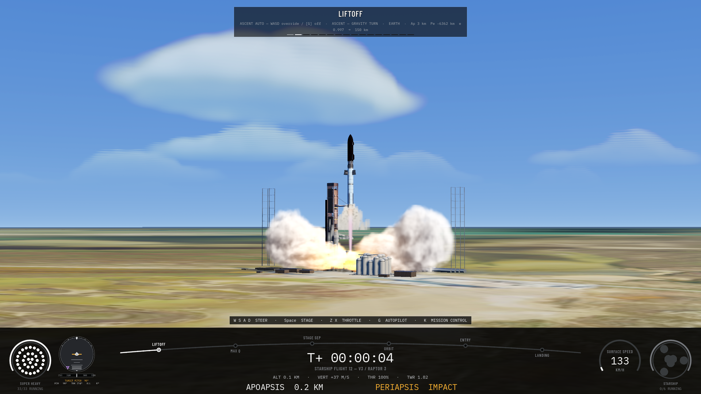
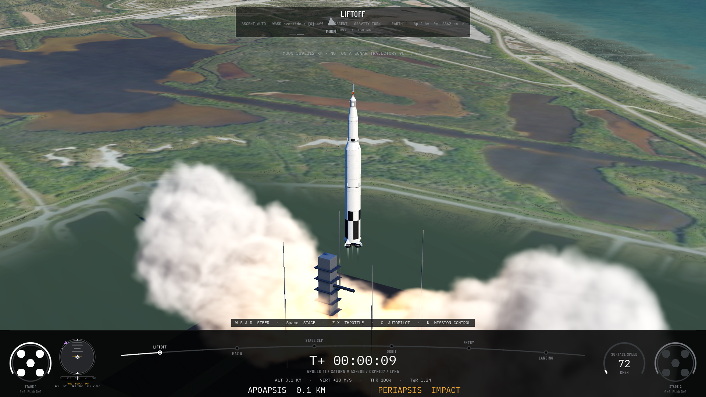
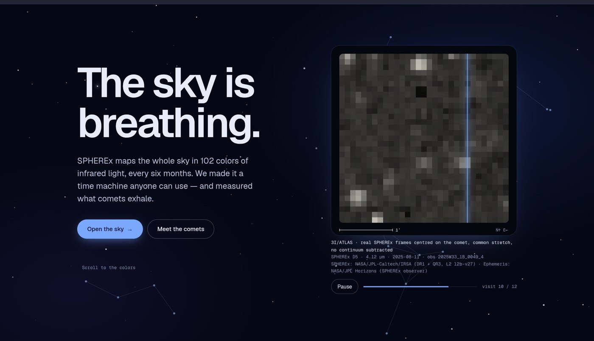
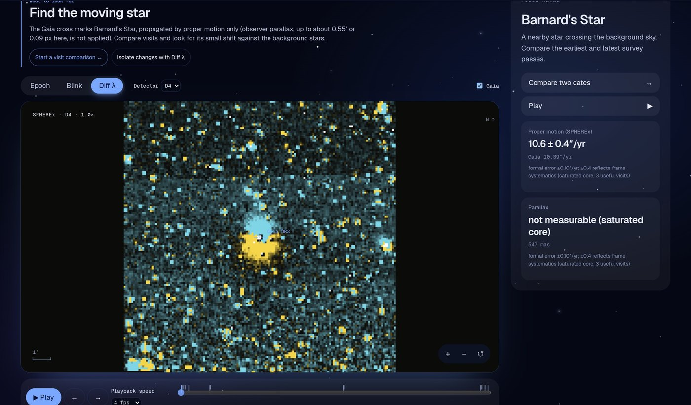
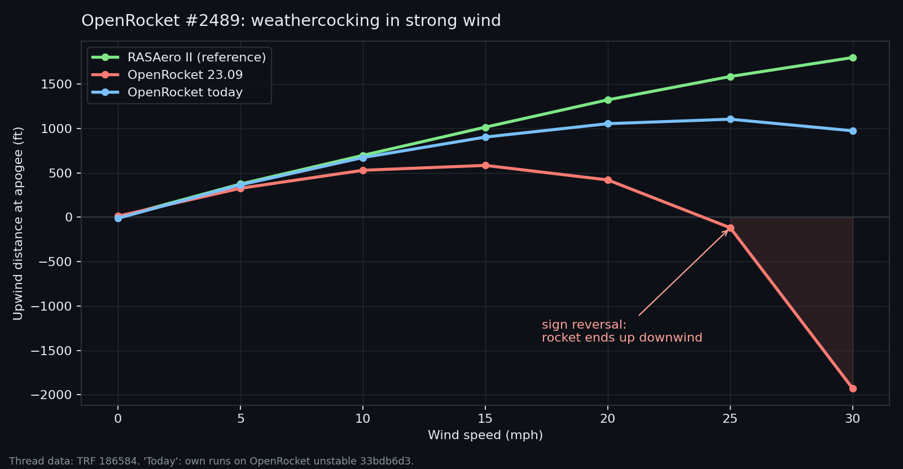
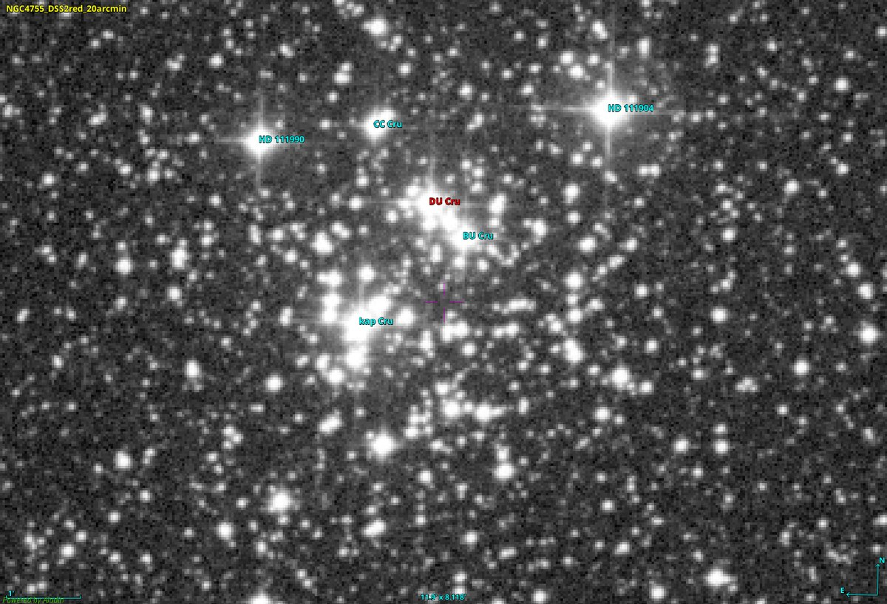
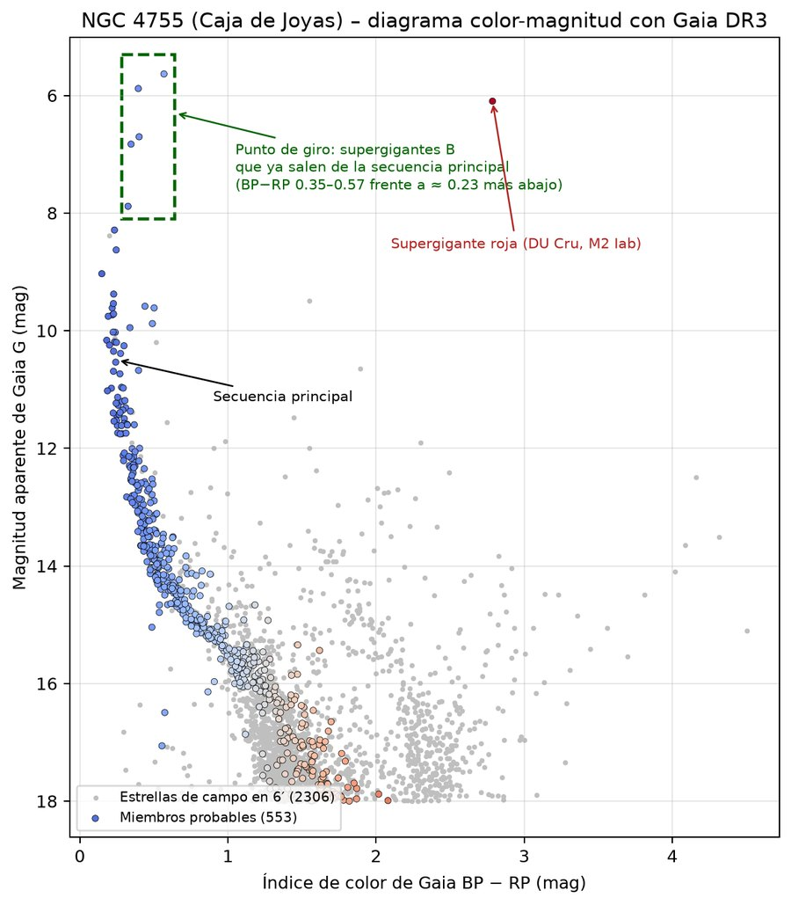

# Sebastian Velandia

**Electronics engineer in Bogotá, Colombia** 
Simulation, validation and data tools for space and rocketry.

  
  
  
  
  
  

  <a href="#-exosphere">Exosphere</a> ·
  <a href="#-breathing-comets">Breathing Comets</a> ·
  <a href="#-open-source-openrocket">OpenRocket</a> ·
  <a href="#-aladin-mcp">Aladin MCP</a> ·
  <a href="#-more">More</a>

---

## 🚀 Exosphere

A space-mission simulator in **Godot 4.6 and C#**. You fly the starship vehicle from the pad through ascent, orbit, and reentry, in a double-precision model of the solar system.

  
  

  
  
  
  

Sandbox flight from Starbase, prepared scenarios, a historical campaign from Mercury to Apollo 11, and a vehicle assembly building all use the same physics. MIT licensed. [Source](https://github.com/sebastianvelace/Exosphere).

---

## 🌠 Breathing Comets

**[breathingcomets.org](https://breathingcomets.org)** · [source](https://github.com/sebastianvelace/Breathing-Comets) · English and Spanish

NASA's SPHEREx maps the whole sky in 102 infrared colors. Breathing Comets turns that public data into something you can touch: play real exposures, blink two dates, subtract the sky at matched wavelengths, and click any position for a measured spectrum. Then follow the same data to comets that exhale CO₂ and to near-Earth asteroids sized after NEOWISE.

  
  

- **Measured, not illustrated.** Spectra come from real SPHEREx frames, with the provenance and the downloadable stack on each comet page.
- **Checked against the literature.** The 3I/ATLAS CO₂ production rate falls inside the published range, and the page says so.
- **Honest about limits.** Systematics and saturated cores are flagged on the page instead of hidden.

---

## 🔧 Open source: OpenRocket

Two merged pull requests to [OpenRocket](https://github.com/openrocket/openrocket), the open-source model rocket simulator (3k+ stars).

| PR | What it fixes |
|---|---|
| [#3189](https://github.com/openrocket/openrocket/pull/3189) | Wind models now take the simulation's random seed, so flights with turbulence are reproducible. ([#3188](https://github.com/openrocket/openrocket/issues/3188)) |
| [#3190](https://github.com/openrocket/openrocket/pull/3190) | Tumbling is detected from a *sustained* angle of attack measured against the rocket's own pitch period, not an instantaneous one. ([#3183](https://github.com/openrocket/openrocket/issues/3183)) |

**Investigation: [issue #2489](https://github.com/sebastianvelace/openrocket-2489-weathercock).** In strong wind, OpenRocket's simulated weathercocking stops growing and can reverse sign, while RASAero II keeps growing. The write-up traces it to the body crossflow term: its coefficient (K = 1.1) is the value for an infinitely long cylinder, but the reference method it comes from scales it down for finite-length bodies. Confirmed three independent ways, including a stand-alone simulator that reproduces OpenRocket within 1–4 %.

  

---

## 🔭 Aladin MCP

**[aladin-mcp](https://github.com/sebastianvelace/aladin-mcp)** is an MCP server that lets Claude work with the CDS ecosystem in Strasbourg: **SIMBAD**, **VizieR**, **HiPS** survey images and **Aladin Desktop** over SAMP. Seven tools, from object lookups to color-magnitude diagrams. It was built for an astronomy workshop on the Large Magellanic Cloud and the open cluster NGC 4755.

  
  

---

## 📦 More

- [**rocketry-engineering**](https://github.com/sebastianvelace/rocketry-engineering): an end-to-end experimental rocketry effort covering propulsion, structures, hardware testing and data acquisition.
- [**Rocky**](https://github.com/sebastianvelace/Rocky): a local-intelligence kernel for Linux (Tauri/Rust, FastAPI, Next.js).
- [**kicad-circuit-ai**](https://github.com/sebastianvelace/kicad-circuit-ai): a circuit intelligence layer for KiCad that finds logic errors ERC/DRC cannot see.

Ordinary people can choose to be extraordinary.

